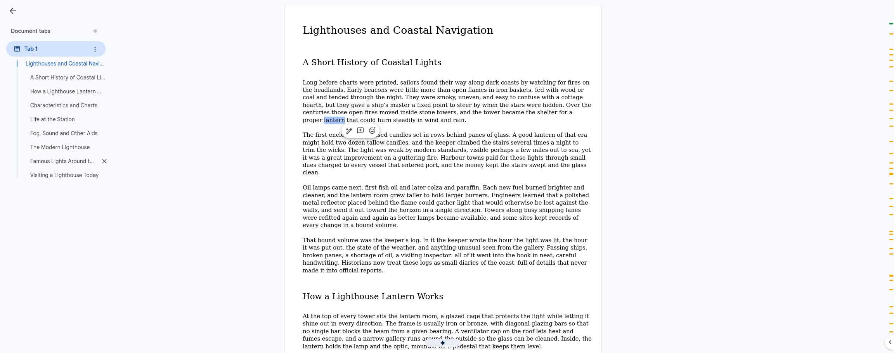
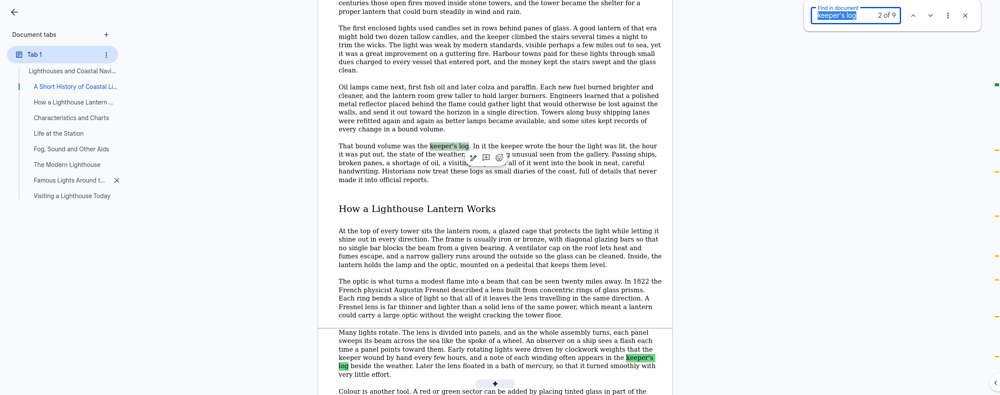

# js_scripts

Userscripts, templates and small JavaScript snippets. Each userscript lives in
its own folder under `userscripts/`, next to the console probes that measured the
page behaviour it relies on. How each one works, its known traps and the
measured facts behind it are in [docs/](docs/README.md).

## Userscripts

Install a userscript manager such as [Violentmonkey](https://violentmonkey.github.io/),
then open the install link. The manager picks up new versions from the same link.

| script | what it does | install |
|---|---|---|
| [gdocs-find-helpers](userscripts/gdocs-find-helpers/) | Google Docs: ticks beside the scrollbar for every find match in the tab; double-click a word to mark all its occurrences; Cmd/Ctrl+F fills the find box with your selection | [gdocs-find-helpers.user.js](https://raw.githubusercontent.com/luutuankiet/js_scripts/main/userscripts/gdocs-find-helpers/gdocs-find-helpers.user.js) |

### gdocs-find-helpers in action

Double-click a word: every match gets a tick beside the scrollbar, and Docs'
find bar opens and closes out of sight.

Select a phrase, then press Cmd/Ctrl+F: the find box is filled with it.

Images live on the `assets` branch, which is never merged into `main`.

## Layout

| path | what |
|---|---|
| `userscripts/<name>/<name>.user.js` | the script |
| `userscripts/<name>/probes/` | devtools-console scripts used to measure the host page |
| `docs/` | architecture, traps, reference facts and decision records |

## Author

kietluu.it@gmail.com
