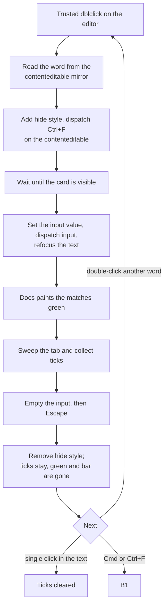
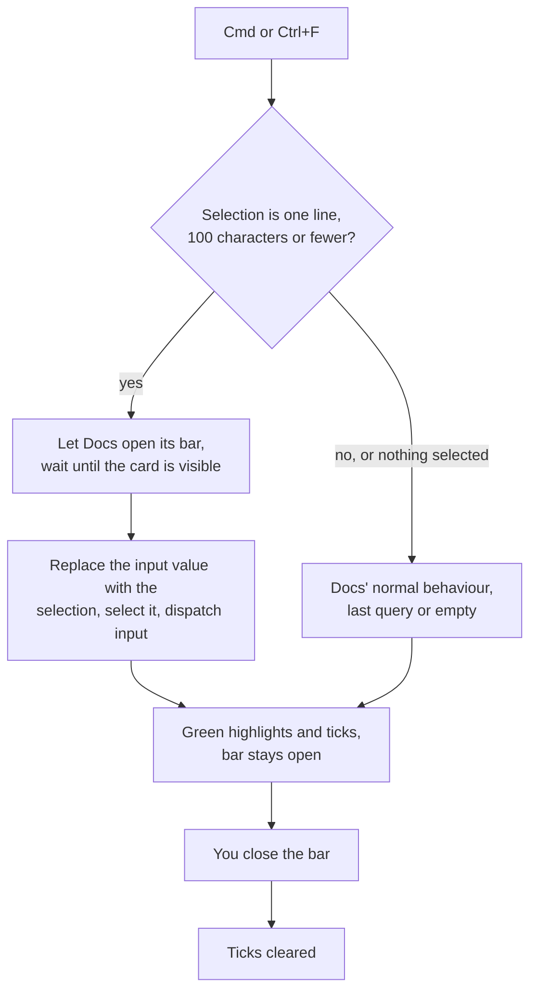

# gdocs-find-helpers

Script: `userscripts/gdocs-find-helpers/gdocs-find-helpers.user.js`. It adds
three things to Google Docs: a tick beside the scrollbar for every find match in
the current document tab, a double-click that marks every occurrence of the
clicked word, and Cmd/Ctrl+F that fills the find box with the current selection.

Everything below rests on measurements made in Firefox 145 on Linux in November
2026; the scripts that took them are in `userscripts/gdocs-find-helpers/probes/`.
Docs is not a stable API. When something stops working, rerun the probes before
reading the code.

## Docs draws text on canvas

The document body is not DOM text. Docs paints it onto canvas tiles,
`canvas.kix-canvas-tile-content`, inside the scroller `.kix-appview-editor`, and
only paints tiles near the viewport. Docs also keeps spare hidden tiles, so the
script only reads tiles with a non-zero size and `offsetHeight`. The selection
highlight is painted too: the `<svg>` in each tile is empty and there are no
selection rect elements. Anything that walks DOM text nodes sees nothing.

## Match ticks come from pixel colours

When Docs' find bar has a query, Docs paints each match with a green background:
the current match `rgb(109, 213, 140)`, every other match `rgb(196, 238, 208)`.
The script copies each visible tile, scaled down to one pixel per 3x2 CSS
pixels with smoothing off so colours stay exact, onto a small scratch canvas and
reads it with `getImageData`. A row with at least 2 sampled pixels within 7 per
channel of either green is a match row; rows containing the darker green are the
current match. Each row becomes a tick at `y / scrollHeight` of the strip drawn
beside the scrollbar. Clicking a tick scrolls the match to a third of the way
down the view.

The total in Docs' counter (`"3 of 14"`) counts all document tabs, while the
ticks only cover the current tab, because only the current tab is painted.

## The sweep behind a frozen picture

Because Docs only paints near the viewport, the script reads the whole tab by
scrolling through it once, a *sweep*, after the query has been stable for
200 ms:

1. **Freeze.** Draw the visible tiles, page backgrounds and loaded images onto
   one canvas laid over the page (z-index 1000, above Docs' text layer at 22 and
   below its find bar at 1003), plus a narrow canvas over the scrollbar with a
   still thumb. A style rule hides `.kix-scrollbarwidget`, the page-number label
   Docs pops up on every scroll.
2. **Step.** Set `scrollTop`, dispatch a `scroll` event so Docs moves its tiles
   at once, then wait two animation frames for the repaint. One frame is too
   early: the tiles still hold the old pixels.
3. **Read and merge.** Read only tiles not read before, replace any ticks known
   for the stretch each tile covers, aim the next stop one tile past what has
   been read, and go back once for any gap left behind.
4. **Restore.** Scroll back to where you were (or to where Docs moved the page
   meanwhile) and remove the frozen picture.

A sweep stops early if the query changes, or on any key, click or scroll. v0.3
capped it at 4 s or 600 stops. v0.4 always sweeps the whole tab and keeps only a
safety limit (`SWEEP_MAX_MS` 20 s, `SWEEP_MAX_STEPS` 2000). It skips the sweep
entirely when the tiles already painted cover the whole tab (`coversAll`).
Between sweeps, only the tiles on screen are re-read when you step through
matches or scroll.

Docs can paint the green a few frames after the counter changes, most often
when the same query is searched again. So when the first look finds no green
but the counter is not zero, the script retries for up to `PAINT_FRAMES` (6)
frames.

## Reading the selection

Docs mirrors the selected text into a contenteditable `div` inside
`iframe.docs-texteventtarget-iframe` (the iframe sits off-screen at
`y -10000`). Its `textContent` is the selected text, already set by the time a
`dblclick` handler runs, and empty when the caret is collapsed. It holds styled
HTML, so read `textContent`, not `innerHTML`. No permission or clipboard access
is needed. A single click empties the mirror about 1 ms after mouseup, which a
`MutationObserver` on the mirror sees; the iframe's `selectionchange` follows at
about 6 ms, and the top document gets none.

The selection has no usable on-screen rect. The double-click point
(`clientX/clientY` of the trusted `dblclick`, which reaches `window`, `document`
and `.kix-appview-editor`) is the best position proxy.

## The hidden find bar

Docs only searches while its find bar is open, so a search with no bar at all is
not possible. The script opens the bar invisibly instead:

- **Open** by dispatching a synthetic Ctrl+F `keydown` on the iframe's
  contenteditable. Docs handles it (`defaultPrevented: true`), so Docs' bar
  opens, not the browser's. The card is `.appsDocsUiWizFindbarCard`; the input
  is `input[aria-label="Find in document"]`.
- **Hide** with a style rule giving the card `opacity: 0` and an off-screen
  transform. Measured: the card was painted in 0 of 29 frames and the search
  still ran. Hiding an ancestor with `visibility: hidden` also works, but then
  the card's own computed `visibility` no longer tells you the bar is open.
- **Search** by calling the native `value` setter of `HTMLInputElement` and
  dispatching `input`. Green appears about 24 to 31 ms later.
- **Refocus** the contenteditable; the highlights and selection stay.
- **Close** by emptying the input first, then dispatching Escape on it. Closing
  any other way moves your selection to Docs' current match.

Whether the bar is open is read from the computed `visibility` of the card,
never from its presence or `offsetParent`: the closed bar stays in the DOM.

## Flow: double-click a word

Measured in Firefox, November 2026, in a short doc: 239 ms from double-click to
bar closed on a warm page and 349 ms on the first use after a reload. That leaves
out the 300 ms wait that skips triple-clicks. Any key pressed during the flow
cancels it and closes the bar safely.

## Flow: select, then Cmd/Ctrl+F

Waiting for the card matters: filled in at once, Docs overwrites the value with
its last query about 65 ms later. Because the double-click flow empties the
input before closing, a plain Cmd/Ctrl+F after a double-click opens an empty box.

## The general rule

On a canvas-rendered page, read what the page itself paints and steer the page's
own controls, rather than re-implementing its search: the pixels and the find
bar are the only interfaces Docs exposes, and both are measured, so date every
number and keep the probe that measured it.
