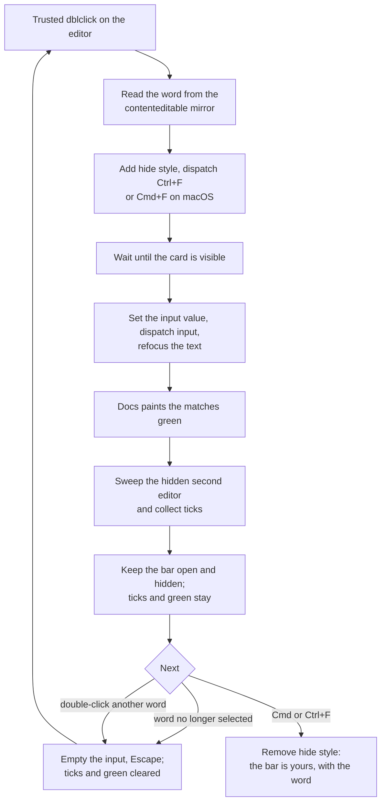
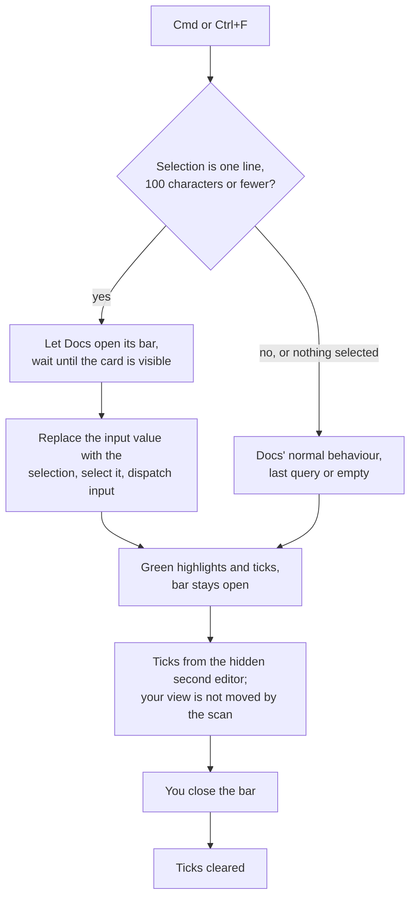

# gdocs-find-helpers

Script: `userscripts/gdocs-find-helpers/gdocs-find-helpers.user.js`. It adds
three things to Google Docs: a tick beside the scrollbar for every find match in
the current document tab, a double-click that marks every occurrence of the
clicked word, and Cmd/Ctrl+F that fills the find box with the current selection.

Everything below rests on measurements made in Firefox 145 on Linux in November
2026, and on macOS where marked; the scripts that took them are in `userscripts/gdocs-find-helpers/probes/`.
Docs is not a stable API. When something stops working, rerun the probes before
reading the code.

## Docs draws text on canvas

The document body is not DOM text. Docs paints it onto canvas tiles,
`canvas.kix-canvas-tile-content`, inside the scroller `.kix-appview-editor`, and
only paints tiles near the viewport. Docs also keeps spare hidden tiles, so the
script only reads tiles with a non-zero size and `offsetHeight`. The selection
highlight is painted too: the `<svg>` in each tile is empty and there are no
selection rect elements. Anything that walks DOM text nodes sees nothing.

## Match ticks come from pixel colours

When Docs' find bar has a query, Docs paints each match with a green background:
the current match `rgb(109, 213, 140)`, every other match `rgb(196, 238, 208)`.
The script copies each visible tile, scaled down to one pixel per 3x2 CSS
pixels with smoothing off so colours stay exact, onto a small scratch canvas and
reads it with `getImageData`. A row with at least 2 sampled pixels within 7 per
channel of either green is a match row; rows containing the darker green are the
current match. Each row becomes a tick at `y / scrollHeight` of the strip drawn
beside the scrollbar. Clicking a tick scrolls the match to a third of the way
down the view.

The total in Docs' counter (`"3 of 14"`) counts all document tabs, while the
ticks only cover the current tab, because only the current tab is painted.

## The sweep, in a hidden second editor

Because Docs only paints near the viewport, the script reads the whole tab by
scrolling an editor through it once, a *sweep*. Since v0.5 the editor it
scrolls is never the one you see (`docs/adr/0003-scan-a-hidden-second-editor.md`):

1. **Load.** On the first double-click or find, add an `inert`, `aria-hidden`
   iframe of the same URL (without `#`), the size of the window, at
   `opacity: 0` and `z-index: -1`. It is ready when its `.kix-appview-editor`
   has painted tiles and its `scrollHeight` has not changed for 600 ms. A style
   rule inside it hides its find card. Measured: about 2 s to ready, and about
   3.5 s of main-thread stalls in bursts while it loads (Firefox, November
   2026). Until it is ready, a scan reads only the tiles painted in your editor.
2. **Search there.** Open its find bar with a synthetic find key on its own
   text-event contenteditable, set the query, and wait for its counter to
   change. Then wait until green is painted in it: the counter updates before
   the green, and reading at once missed every match above the current one (8
   ticks of 32, measured November 2026, Firefox).
3. **Step.** Set `scrollTop`, dispatch `scroll` so Docs moves its tiles at once,
   then wait two animation frames for the repaint. One frame is too early.
4. **Read and merge.** Read only tiles not read before, replace any ticks known
   for the stretch each tile covers, and aim the next stop one tile past what
   has been read.

Nothing there is visible, so there is no cover and no restore. Its bar stays
open between scans holding the last word, so a repeated word costs only a
re-sweep. The rows map 1:1 onto your editor (both scrollers have the same
width); do not scale them by the `scrollHeight` ratio, the difference is bottom
padding. Which match is current comes from your editor: its darker green row
marks the nearest swept row within 16 px.

One sweep runs at a time; a newer one, a changed query, a closed bar or a
cancelled flow stops the older one. `SWEEP_MAX_MS` (20 s) and `SWEEP_MAX_STEPS`
(2000) are safety limits only. The sweep is skipped when the tiles already
painted in your editor cover the whole tab (`coversAll`). Between sweeps, only
the tiles on screen are re-read when you step through matches or scroll.

Docs can paint the green a few frames after the counter changes, most often
when the same query is searched again. So when the first look finds no green
but the counter is not zero, the script retries for up to `PAINT_FRAMES` (6)
frames.

## Reading the selection

Docs mirrors the selected text into a contenteditable `div` inside
`iframe.docs-texteventtarget-iframe` (the iframe sits off-screen at
`y -10000`). Its `textContent` is the selected text, already set by the time a
`dblclick` handler runs, and empty when the caret is collapsed. It holds styled
HTML, so read `textContent`, not `innerHTML`.

**On macOS the mirror stays empty** after a double-click or drag, until
something copies (measured November 2026, Firefox, with
`probes/probe-7-mac-selection.js`). There the script dispatches a synthetic
`ClipboardEvent('copy')` on the contenteditable with a fresh `DataTransfer` and
reads the text Docs writes into that event's `clipboardData`. It fills the
mirror too, and the system clipboard is not touched. An empty mirror therefore
does not mean "nothing selected" on macOS; compare against the expected word
instead. No permission or clipboard access is needed on either platform. A single click empties the mirror about 1 ms after mouseup, which a
`MutationObserver` on the mirror sees; the iframe's `selectionchange` follows at
about 6 ms, and the top document gets none.

The selection has no usable on-screen rect. The double-click point
(`clientX/clientY` of the trusted `dblclick`, which reaches `window`, `document`
and `.kix-appview-editor`) is the best position proxy.

## The hidden find bar

Docs only searches while its find bar is open, so a search with no bar at all is
not possible. The script opens the bar invisibly instead:

- **Open** by dispatching a synthetic Ctrl+F `keydown` on the iframe's
  contenteditable; Cmd+F on macOS, where Docs ignores Ctrl+F. Docs handles it (`defaultPrevented: true`), so Docs' bar
  opens, not the browser's. The card is `.appsDocsUiWizFindbarCard`; the input
  is `input[aria-label="Find in document"]`.
- **Hide** with a style rule giving the card `opacity: 0` and an off-screen
  transform. Measured: the card was painted in 0 of 29 frames and the search
  still ran. Hiding an ancestor with `visibility: hidden` also works, but then
  the card's own computed `visibility` no longer tells you the bar is open.
- **Search** by calling the native `value` setter of `HTMLInputElement` and
  dispatching `input`. Green appears about 24 to 31 ms later.
- **Refocus** the contenteditable; the highlights and selection stay.
- **Keep it open** after a double-click, so Docs keeps the green on every
  match (`docs/adr/0004-keep-the-hidden-find-bar-open.md`). It closes when the
  word is no longer selected, on the next double-click, or when Docs closes it.
  Cmd/Ctrl+F while it is open removes the hide rule and hands the bar to you.
- **Close** by emptying the input first, then dispatching Escape on it. Closing
  any other way moves your selection to Docs' current match.

Whether the bar is open is read from the computed `visibility` of the card,
never from its presence or `offsetParent`: the closed bar stays in the DOM.

## Flow: double-click a word

Measured in Firefox, November 2026, on a 5-page doc with the hidden editor
ready: the sweep took about 300 ms in 2 steps, after the 300 ms wait that skips
triple-clicks. Any key pressed during the flow cancels it and closes the bar
safely.

## Flow: select, then Cmd/Ctrl+F

Waiting for the card matters: filled in at once, Docs overwrites the value with
its last query about 65 ms later. Typing in the box or pressing Enter makes
Docs jump to the current match; that is Docs' own behaviour, not the scan.

## The general rule

On a canvas-rendered page, read what the page itself paints and steer the page's
own controls, rather than re-implementing its search: the pixels and the find
bar are the only interfaces Docs exposes, and both are measured, so date every
number and keep the probe that measured it.
